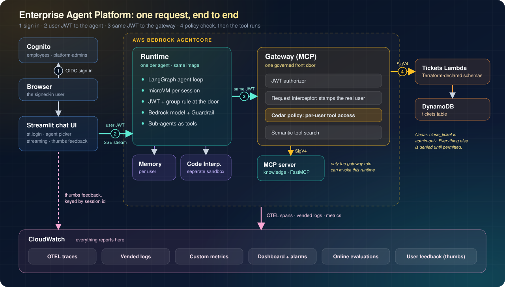

<p align="center">
  
</p>

<p align="center">
  <b><h1>Enterprise Agent System</h1></b><br>
  <b>An open-source platform for running AI agents for your company. Built on AWS Bedrock AgentCore. Managed entirely with Terraform.</b><br>
</p>

<p align="center">
  <!--img src="https://img.shields.io/badge/AWS-Bedrock%20AgentCore-ff9900?style=flat-square" alt="AWS Bedrock AgentCore"-->
  
  
  <!--img src="https://img.shields.io/badge/Tools-MCP-2563eb?style=flat-square" alt="MCP"-->
  
  
</p>

<br>

---

- **Agents are Python files.** Set a prompt, tools and a model in an `AgentSpec`. The platform handles the rest.
- **Tools are Python MCP servers or Lambdas.** All of them sit behind one governed **AgentCore Gateway**.
- **Every call runs as the signed-in user.** The user's token flows from the chat UI to the agent, the gateway, the tool policy and the tool.
- **Observability is built in.** OTEL traces, the GenAI Observability console, a dashboard, alarms, user feedback and LLM-judged online evaluations, all on CloudWatch.
- **One chat UI.** Streamlit with SSO, an agent picker and streaming.


---

<!--## Architecture


<p align="center">
  
</p>-->


## Quick start

### Prerequisites

| You need | Notes |
|---|---|
| **AWS account** with Bedrock AgentCore available | Default region is `us-west-2` |
| **Bedrock model access** | For the model you choose |
| **Terraform** 1.10+ | |
| **Docker with buildx** | AgentCore needs `linux/arm64` images. buildx cross-builds them on x86 |
| **AWS CLI v2** and **Python** 3.10+ | |

### Deploy

```bash
make install                 # local venv for tests, local runs and the UI
make test                    # 21 tests, no AWS needed

# deploy (uses the AWS credentials in your shell)
make deploy                  # validates agents, builds arm64 images, terraform apply, writes UI config

make user EMAIL=you@example.com ADMIN=1   # Cognito emails a temporary password
make ui                                    # http://localhost:8501
```

The first deploy takes about 10–15 minutes. Things to know:
- **`policy_mode` defaults to `LOG_ONLY`.** Gateway policy decisions are logged but not enforced. Check them in the gateway logs, then set `policy_mode = "ENFORCE"` in `infra/terraform.tfvars` and redeploy.
- **Transaction Search is switched on account-wide.** If your account already manages it, set `enable_transaction_search = false`.
- **The default model is set in [eap/spec.py](eap/spec.py) (`DEFAULT_MODEL_ID`).** Each agent can override it. Use a model or inference profile that is enabled in your account and region.

Run `make destroy` to tear everything down.

## Add an agent

```python
# agents/expenses.py
from eap import AgentSpec, prompt_from_file

agent = AgentSpec(
    name="expenses",
    description="Answers questions about the expenses policy and checks receipts.",
    system_prompt=prompt_from_file("prompts/expenses.md", relative_to=__file__),
    tools=["knowledge___search_policies", "knowledge___get_policy"],
    builtin_tools=["code_interpreter"],
    memory=True,
    allowed_groups=["employees"],
)
```

Run `make deploy`. You get a new runtime, IAM role, alarms, online evaluation and an entry in the UI. See [docs/adding-an-agent.md](docs/adding-an-agent.md) for every option, including custom LangGraph workflows and sub-agents.

## Add a tool

| Kind | How | Guide |
|---|---|---|
| **Python MCP server** | Copy `mcp_servers/knowledge`, then add a runtime and a gateway target in Terraform | [docs/adding-an-mcp-server.md](docs/adding-an-mcp-server.md) |
| **Lambda** | Add a function and an `aws_bedrockagentcore_gateway_target` with its tool schema, as the `tickets` target does | [lambdas/tickets/](lambdas/tickets/) |

In both cases, permit the new tool in [infra/policy.tf](infra/policy.tf). It is denied until you do.

---

## What's included

| Need | How it's done | Where |
|---|---|---|
| Agents without boilerplate | `AgentSpec` in `agents/<name>.py`, prompt in markdown | [agents/](agents/), [eap/spec.py](eap/spec.py) |
| Agent hosting | One AgentCore Runtime per agent, all running the same LangGraph image. microVM per session, 8h sessions | [eap/runtime/](eap/runtime/), [infra/agents.tf](infra/agents.tf) |
| Autonomous agents | LangChain `create_agent` tool-calling loop (custom LangGraph graphs optional) | [eap/runtime/builder.py](eap/runtime/builder.py) |
| Multi-agent | `sub_agents=[...]`: agents call other agents as tools, with the same user identity | [agents/it_helpdesk.py](agents/it_helpdesk.py) |
| Python MCP servers | FastMCP on AgentCore Runtime (`server_protocol = "MCP"`), reachable only through the gateway | [mcp_servers/knowledge/](mcp_servers/knowledge/), [infra/mcp_servers.tf](infra/mcp_servers.tf) |
| Lambda tools | Gateway Lambda target with Terraform-declared tool schemas | [lambdas/tickets/](lambdas/tickets/), [infra/gateway.tf](infra/gateway.tf) |
| Tool gateway | AgentCore Gateway: JWT inbound, semantic tool search, request interceptor | [infra/gateway.tf](infra/gateway.tf), [lambdas/interceptor/](lambdas/interceptor/) |
| Per-user tool permissions | Cedar policies at the gateway (default deny, admin-only tools) | [infra/policy.tf](infra/policy.tf) |
| SSO and identity | Cognito user pool and groups. Runtime JWT authorizer with group check | [infra/auth.tf](infra/auth.tf) |
| Memory | AgentCore Memory: conversation checkpoints plus long-term facts and preferences per user | [eap/runtime/memory.py](eap/runtime/memory.py), [infra/memory.tf](infra/memory.tf) |
| Safety | Bedrock Guardrail on every model call (prompt attacks, harmful content, secrets and PII) | [infra/guardrail.tf](infra/guardrail.tf) |
| Code execution | AgentCore Code Interpreter as a built-in tool | [eap/runtime/tools.py](eap/runtime/tools.py) |
| Observability | ADOT/OTEL traces, Transaction Search, vended gateway and memory logs, usage logs, dashboard, alarms | [infra/observability.tf](infra/observability.tf), [eap/runtime/metrics.py](eap/runtime/metrics.py) |
| Quality monitoring | Online evaluations: goal success, helpfulness, correctness, tool selection | [infra/evals.tf](infra/evals.tf) |
| Chat UI | Streamlit with `st.login` (OIDC), agent picker, streaming, tool status, thumbs feedback | [frontend/app.py](frontend/app.py) |
| No clickops | Everything is Terraform. `scripts/deploy.sh` builds images and applies | [infra/](infra/), [scripts/](scripts/) |

---

## Repository layout

```text
agents/            agent definitions (AgentSpec) + prompts/*.md
eap/               the SDK (spec, registry, manifest) and the shared runtime
runtime/           Dockerfile for the shared agent image
mcp_servers/       Python MCP servers (one dir each, own Dockerfile)
lambdas/           Lambda tools and the gateway interceptor
frontend/          Streamlit chat UI
infra/             Terraform to set up all infrastructure (Cognito, AgentCore, Gateway, Memory, Guardrail, Observability, Alarms, Evals)
scripts/           deploy / destroy / create_user / configure_frontend
tests/             unit and integration tests (no AWS)
```

---

## How it works

[docs/architecture.md](docs/architecture.md) covers the request flow, the identity and trust model, design decisions and known limitations.

---

## Contributing

**Try it on a real setup** - open any issues here: [Open an issue](https://github.com/sarthakrastogi/enterprise-agent-system/issues).

You can also [DM me on LinkedIn 💭](https://www.linkedin.com/in/sarthakrastogi/) to discuss any issues.

## License

Apache-2.0

<br>

<p align="center">
  If this saves you time building an agent platform, consider giving it a ⭐<br>
</p>