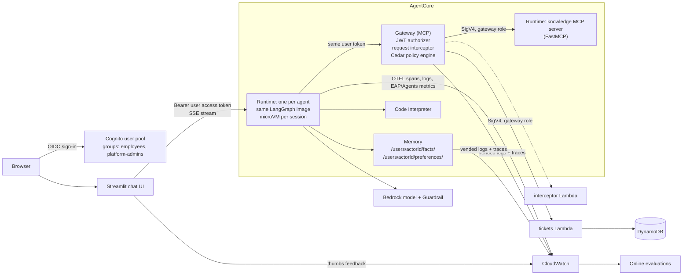

# How to Build an Enterprise AI Agent System with AgentCore (Part 2): The Actual System

*The 7 properties from Part 1, built for real: every resource, every request hop, and the code behind them.*

Part 1 was the "why". It said an enterprise agent system needs seven properties:

1. identity propagation
2. isolation
3. deterministic authorization
4. a governed tool plane
5. scoped memory
6. observability and evals
7. operability as code

It also argued that AWS Bedrock AgentCore maps onto those seven almost one-to-one.

This post is the "how". Everything below is real code in this repository:
- Python agent definitions
- a shared LangGraph agent runtime
- a Python MCP server and a Lambda tool behind AgentCore Gateway
- Cedar policy
- AgentCore Memory
- Bedrock Guardrails
- CloudWatch dashboards, alarms and online evaluations
- a Streamlit chat UI with SSO
- Terraform for every resource

I'll walk through how each piece is built, why it's built that way, and the things that surprised me along the way.

> **Status, honestly.** The code is complete and tested offline: 21 tests cover the agent runtime with a scripted model, the tools, the interceptor, the UI and the config scripts. The Terraform passes `terraform validate` against `hashicorp/aws` 6.70. At the time of writing I have not yet run it end to end in a fresh AWS account, and the agents' answer quality is unevaluated against a real model. The sections below point out where behaviour depends on an AWS detail that only a real deploy will confirm.

---

## Contents

0. [What changed from the plan in Part 1](#0-what-changed-from-the-plan-in-part-1)
1. [The system at a glance](#1-the-system-at-a-glance)
2. [Defining agents: `AgentSpec`](#2-defining-agents-agentspec)
3. [The shared agent runtime](#3-the-shared-agent-runtime)
4. [Property 1: identity propagation](#4-property-1-identity-propagation)
5. [Property 2: isolation](#5-property-2-isolation)
6. [Property 3: deterministic authorization](#6-property-3-deterministic-authorization)
7. [Property 4: a governed tool plane](#7-property-4-a-governed-tool-plane)
8. [Property 5: scoped memory](#8-property-5-scoped-memory)
9. [Property 6: observability and evals](#9-property-6-observability-and-evals)
10. [Property 7: operability as code](#10-property-7-operability-as-code)
11. [The chat UI](#11-the-chat-ui)
12. [Testing without an AWS account](#12-testing-without-an-aws-account)
13. [Gotchas I hit while building it](#13-gotchas-i-hit-while-building-it)
14. [Limitations and what's next](#14-limitations-and-whats-next)

---

## 0. What changed from the plan in Part 1

Part 1 promised a few things that turned out differently once I started writing code.

| Part 1 said | What I built | Why |
|---|---|---|
| YAML-driven agent runtime | **Python `AgentSpec`** files | Typed, validated at import, unit-testable, and they can carry Python where you need it (local tools, custom graphs). YAML ended up re-implementing a schema validator badly. |
| Strands | **LangGraph** (`langchain.agents.create_agent`) | Same autonomous tool-calling loop, framework-neutral for an open-source project, and first-party AgentCore Memory support in `langgraph-checkpoint-aws`. More on this in §3. |
| A CI/CD pipeline | **`scripts/deploy.sh`** with content-hashed images | I kept the first version small. The script does what a pipeline would (build once, immutable tags, `terraform apply`), so wrapping it in CI is mechanical. |
| Evals in CI | **Online evaluations** on live traffic | The dataset gate needs a deployed agent to produce traces. It's the next thing to add. |
| Entra/Okta and OBO token exchange | **Cognito**, user JWT end to end, gateway-role SigV4 to tools, plus an **identity interceptor** | Cognito keeps the repo self-contained. OBO needs a downstream API that accepts exchanged tokens; my demo tools are my own Lambda and MCP server. §4 explains what that does and doesn't cover. |

The seven properties are all there. A couple of them are thinner than the Part 1 ideal, and I'll say where.

---

## 1. The system at a glance



### One chat turn, end to end

1. **Sign-in.** The user signs in to the Streamlit app with Cognito. The app holds the user's **access token**.
2. **UI → agent.** The app calls `POST /runtimes/<agent ARN>/invocations` with `Authorization: Bearer <token>` and a session id of at least 33 characters.
3. **Runtime authorization.** AgentCore Runtime's **JWT authorizer** checks the signature, the issuer, `client_id` and the agent's group rule. The request never reaches agent code if any of these fails.
4. **Agent setup.** AgentCore routes the session to its **own microVM**, running the shared image with `AGENT_NAME=it_helpdesk`. The agent code then:
   - reads the caller from the already-validated token;
   - recalls the user's long-term memories;
   - fetches the user's tools from Gateway using **the same token**.
5. **The loop.** The LangGraph agent runs autonomously: model → tool → model → … → answer. Text streams back as SSE.
6. **Each tool call.** Gateway does four things:
   - validates the token again;
   - lets the **interceptor** stamp the real user onto the call;
   - asks **Cedar** whether this user may call this tool;
   - calls the tool with its own IAM role.
7. **After the turn.** The turn is written to Memory, metrics go to CloudWatch, and online evaluation samples the session later.

### Repository layout

```
agents/            agent definitions (AgentSpec) + prompts/*.md
eap/               the SDK (spec, registry, manifest) and the shared runtime
  runtime/         app.py (entrypoint), builder.py, identity.py, memory.py, tools.py, metrics.py
runtime/           Dockerfile for the shared agent image
mcp_servers/       Python MCP servers (knowledge/)
lambdas/           tickets tool + gateway interceptor
frontend/          Streamlit chat UI
infra/             Terraform: one file per concern
scripts/           deploy / destroy / create_user / configure_frontend
tests/             21 tests, no AWS needed
```

---

## 2. Defining agents: `AgentSpec`

The person writing an agent should only have to say what the agent is for. The platform should supply everything else: hosting, auth, tools, memory, tracing and evaluation.

### What a user writes

```python
# agents/it_helpdesk.py
from eap import AgentSpec, prompt_from_file

agent = AgentSpec(
    name="it_helpdesk",
    display_name="IT Helpdesk",
    description="Answers IT and policy questions from the company knowledge base and files or tracks support tickets.",
    system_prompt=prompt_from_file("prompts/it_helpdesk.md", relative_to=__file__),
    tools=[
        "knowledge___search_policies",
        "knowledge___get_policy",
        "tickets___create_ticket",
        "tickets___get_ticket",
        "tickets___list_my_tickets",
        "tickets___close_ticket",       # Cedar policy only lets platform-admins call this
    ],
    sub_agents=["data_analyst"],
    memory=True,
    allowed_groups=["employees"],
    version="0.1.0",
)
```

The prompt lives in markdown next to it (`agents/prompts/it_helpdesk.md`). Prompts are the part people edit most, and markdown diffs well in review.

### The spec itself

`AgentSpec` is a frozen dataclass that validates itself on construction ([eap/spec.py](../eap/spec.py)):

```python
_NAME_RE = re.compile(r"^[a-z][a-z0-9_]{1,31}$")
BUILTIN_TOOLS = {"code_interpreter"}

@dataclass(frozen=True)
class AgentSpec:
    name: str
    description: str
    system_prompt: str
    display_name: str = ""
    model_id: str = DEFAULT_MODEL_ID
    temperature: float = 0.2
    max_tokens: int = 4096
    tools: tuple[str, ...] = ()
    builtin_tools: tuple[str, ...] = ()
    sub_agents: tuple[str, ...] = ()
    local_tools: tuple["BaseTool", ...] = field(default=(), compare=False)
    memory: bool = False
    allowed_groups: tuple[str, ...] = ()
    graph_factory: Callable[..., Any] | None = field(default=None, compare=False)
    version: str = "0.1.0"

    def __post_init__(self) -> None:
        # Accept lists from users, store tuples so specs stay hashable/immutable.
        for attr in ("tools", "builtin_tools", "sub_agents", "local_tools", "allowed_groups"):
            object.__setattr__(self, attr, tuple(getattr(self, attr)))
        ...
        self.validate()
```

**The name rule is not cosmetic.** The name becomes the AgentCore runtime name (`eap_it_helpdesk`). Runtime names only allow `[a-zA-Z0-9_]` and no hyphens. Validating at import time means a bad name fails `make manifest` on your laptop, not halfway through a `terraform apply`.

### Discovery

There's no registration step. [eap/registry.py](../eap/registry.py) imports every module in `agents/` and collects its `agent` attribute. It also rejects duplicate names, unknown sub-agents and delegation cycles:

```python
@lru_cache(maxsize=1)
def load_agents(package: str = "agents") -> dict[str, AgentSpec]:
    pkg = importlib.import_module(package)
    specs: dict[str, AgentSpec] = {}
    for info in pkgutil.iter_modules(pkg.__path__):
        if info.name.startswith("_"):
            continue
        module = importlib.import_module(f"{package}.{info.name}")
        spec = getattr(module, "agent", None)
        if not isinstance(spec, AgentSpec):
            raise TypeError(f"{package}/{info.name}.py must define `agent = AgentSpec(...)`")
        ...
    _check_no_cycles(specs)
    return specs
```

### The bridge to Terraform: the manifest

Terraform can't import Python, and it shouldn't see prompts. So `python -m eap.manifest` exports only the fields that change infrastructure:

```json
{
  "it_helpdesk": {
    "allowed_groups": ["employees"],
    "code_interpreter": true,
    "description": "Answers IT and policy questions ...",
    "display_name": "IT Helpdesk",
    "memory": true,
    "name": "it_helpdesk",
    "version": "0.1.0"
  }
}
```

`it_helpdesk` doesn't use Code Interpreter itself, yet `code_interpreter` is `true` for it. That's because its sub-agent `data_analyst` runs **inside `it_helpdesk`'s runtime** (§3), so `it_helpdesk`'s IAM role needs the sandbox permission too. The manifest computes that across each agent's sub-agents:

```python
family = [specs[n] for n in closure(name)]
entry["memory"] = any(s.memory for s in family)
entry["code_interpreter"] = any("code_interpreter" in s.builtin_tools for s in family)
```

I originally got this wrong. The test that caught it now asserts it explicitly.

---

## 3. The shared agent runtime

### One image, many runtimes

Every agent runs the **same container image**, and an environment variable picks which spec to load. Terraform still creates **one AgentCore Runtime per agent**. Each runtime gets its own IAM role, JWT group rule, log group, alarms and evaluation config, and its own immutable version history.

This gives you one tested artifact while keeping per-agent blast radius and observability.

### The AgentCore Runtime contract

AgentCore Runtime runs any container that follows a small HTTP contract:

| | |
|---|---|
| Architecture | `linux/arm64` (required) |
| Port | `8080` (HTTP protocol), `8000` (MCP), `9000` (A2A) |
| Endpoints | `POST /invocations` (JSON in, JSON or SSE out), `GET /ping` |
| Session | header `X-Amzn-Bedrock-AgentCore-Runtime-Session-Id`, ≥ 33 chars |

The `bedrock-agentcore` SDK's `BedrockAgentCoreApp` implements that contract. If your entrypoint is an **async generator**, every value you `yield` is serialized as an SSE `data: <json>` event. That's all the streaming plumbing you need.

```dockerfile
# runtime/Dockerfile
FROM --platform=linux/arm64 public.ecr.aws/docker/library/python:3.13-slim
ENV PYTHONUNBUFFERED=1 PIP_NO_CACHE_DIR=1
WORKDIR /app
COPY pyproject.toml README.md ./
COPY eap ./eap
COPY agents ./agents
RUN pip install ".[otel]"
RUN useradd --create-home app && chown -R app /app
USER app
EXPOSE 8080
# opentelemetry-instrument + ADOT sends LangChain/LangGraph spans to CloudWatch.
CMD ["opentelemetry-instrument", "python", "-m", "eap.runtime.app"]
```

### Why LangGraph, and is it still "autonomous"?

A fair worry with LangGraph is that you have to draw a graph. You don't. `langchain.agents.create_agent` is the same free tool-calling loop as Strands or the OpenAI Agents SDK: the model decides which tools to call and when it's done.

A graph only appears if an agent sets `graph_factory`. That's the escape hatch for a fixed workflow such as a triage classifier.

Compared with Strands, what you give up is mostly convenience on AWS:
- Strands has one-line helpers for A2A and Browser, and Harness (AWS's config-only agent loop) is built on it.
- With LangGraph, tracing needs one extra instrumentation package (`opentelemetry-instrumentation-langchain`, included in the `otel` extra).

### The entrypoint

[eap/runtime/app.py](../eap/runtime/app.py) does four jobs:
1. validate input;
2. establish who is calling;
3. build and stream the agent;
4. record what happened.

```python
@app.entrypoint
async def invoke(payload: dict, context) -> AsyncIterator[dict]:
    s = settings()
    prompt = payload.get("prompt") if isinstance(payload, dict) else None
    if not isinstance(prompt, str) or not prompt.strip():
        yield {"type": "error", "message": "payload must be {\"prompt\": \"<non-empty string>\"}"}
        return
    ...
    caller = caller_from_headers(context.request_headers, local_dev=s.local_dev)
    spec = load_agents()[s.agent_name]
    ...
    built = await build_agent(spec, caller, session_id, s, user_text=prompt)
    async for chunk, meta in built.graph.astream(
        {"messages": [{"role": "user", "content": prompt}]},
        built.config,
        stream_mode="messages",
    ):
        node = _top_level_node(meta)
        if node == "tools" and chunk.type == "tool":
            tool_calls += 1
            yield {"type": "tool_result", "name": chunk.name, "ok": chunk.status != "error"}
            continue
        if node != "model":
            continue
        for call in getattr(chunk, "tool_call_chunks", None) or []:
            if call.get("name"):
                yield {"type": "tool_call", "name": call["name"]}
        text = chunk.text
        if text:
            answer.append(text)
            yield {"type": "text", "data": text}
    ...
    yield {"type": "done"}
```

The UI and the runtime speak a tiny **event protocol**:

```
data: {"type": "tool_call",   "name": "knowledge___search_policies"}
data: {"type": "tool_result", "name": "knowledge___search_policies", "ok": true}
data: {"type": "text",        "data": "Passwords must be at least "}
data: {"type": "text",        "data": "14 characters."}
data: {"type": "done"}
```

I deliberately don't forward raw LangGraph events. They contain objects that aren't JSON-safe, and they would couple the UI to framework internals.

### Building the agent per request

[eap/runtime/builder.py](../eap/runtime/builder.py) assembles the agent for one caller. Tools depend on who the user is, because Cedar filters `tools/list` per user (§6). So the tool list is built per request, not per process.

```python
async def build_agent(spec, caller, session_id, s, *, user_text="", depth=0) -> BuiltAgent:
    tools: list[BaseTool] = list(spec.local_tools)
    tools += await gateway_tools(s.gateway_mcp_url, caller.access_token, spec.tools)
    if "code_interpreter" in spec.builtin_tools:
        tools.append(code_interpreter_tool(s.region, s.code_interpreter_id))
    specs = load_agents()
    for child_name in spec.sub_agents:
        tools.append(_delegate(specs[child_name], caller, session_id, s, depth))

    recalled = ""
    if spec.memory and depth == 0:
        recalled = memory.recall(s.memory_id, s.region, caller.user_id, user_text)

    model = make_model(spec, s)
    prompt = _system_prompt(spec, caller, recalled)
    saver = memory.checkpointer(s.memory_id if spec.memory else "", s.region)

    if spec.graph_factory is not None:
        graph = spec.graph_factory(model=model, tools=tools, system_prompt=prompt, checkpointer=saver)
    else:
        from langchain.agents import create_agent
        # The default: an autonomous tool-calling loop.
        graph = create_agent(model, tools, system_prompt=prompt, checkpointer=saver, name=spec.name)

    thread = session_id if depth == 0 else f"{session_id}-{spec.name}"
    config = {
        "configurable": {"thread_id": thread, "actor_id": caller.user_id},
        "recursion_limit": 50,
        "metadata": {"agent": spec.name, "user": caller.user_id},
    }
    return BuiltAgent(graph=graph, config=config)
```

`recursion_limit: 50` is a cheap circuit breaker. An agent that ping-pongs between two tools stops instead of burning tokens until the 15-minute request timeout.

The model is Bedrock via `ChatBedrockConverse`, with the platform's Guardrail attached when one is configured:

```python
def make_model(spec, s):
    from langchain_aws import ChatBedrockConverse
    kwargs = {}
    if s.guardrail_id:
        kwargs["guardrail_config"] = {
            "guardrailIdentifier": s.guardrail_id,
            "guardrailVersion": s.guardrail_version or "DRAFT",
            "trace": "enabled",
        }
    return ChatBedrockConverse(model_id=spec.model_id, region_name=s.region,
                               temperature=spec.temperature, max_tokens=spec.max_tokens, **kwargs)
```

### Multi-agent: sub-agents as tools

`sub_agents=["data_analyst"]` turns another agent into a tool called `ask_data_analyst`. The sub-agent:
- is built in-process;
- has **the same caller**, so the same token, the same Cedar decisions and the same audit identity;
- runs on its own conversation thread.

```python
def _delegate(child, caller, session_id, s, depth):
    async def run(task: str) -> str:
        built = await build_agent(child, caller, session_id, s, user_text=task, depth=depth + 1)
        result = await built.graph.ainvoke({"messages": [{"role": "user", "content": task}]}, built.config)
        return result["messages"][-1].text
    return sub_agent_tool(child.name, child.description, run)
```

The tool description tells the parent that the sub-agent "cannot see this conversation", so it must pass the full task. That's a real failure mode of agents-as-tools: the parent sends "do it for those numbers" and the child has no idea what "those" are.

**There's a streaming subtlety.** With `stream_mode="messages"`, LangGraph streams tokens from *every* model call inside the run, including the sub-agent's model running inside the parent's tool call. Without filtering, the user watches the analyst's internal reasoning interleave with the helpdesk's answer. The fix uses LangGraph's checkpoint namespace: nested calls show up as `tools:<id>|model:<id>`.

```python
def _top_level_node(meta):
    # Sub-agents run inside a tool call; their messages surface with a nested
    # checkpoint namespace ("tools:...|model:..."). Only stream the parent's.
    if "|" in meta.get("langgraph_checkpoint_ns", ""):
        return None
    return meta.get("langgraph_node")
```

A test runs a scripted parent and child and asserts that the child's text never reaches the stream (§12).

**When not to do this in-process:** if a sub-agent needs independent scaling, separate ownership or a different IAM boundary, host it as its own runtime and call it over **A2A** (AgentCore Runtime supports `server_protocol = "A2A"`).

---

## 4. Property 1: identity propagation

> Whose permission does the call use? The answer you want is "the user's, delegated".

### The identity provider

Cognito keeps the project self-contained ([infra/auth.tf](../infra/auth.tf)):
- a user pool with admin-only sign-up;
- one app client for the chat UI (authorization-code flow, 60-minute access tokens);
- two groups, `employees` and `platform-admins`.

Groups arrive in the **access token** as the `cognito:groups` claim. That claim drives both agent access (here) and tool access (§6).

To use Entra ID or Okta instead, federate them into the pool, or point the authorizers' `discovery_url` at your IdP and change the group claim name. Nothing else changes.

### Hop 1: UI → agent

Each agent runtime has a **CUSTOM_JWT authorizer**. If the agent declares `allowed_groups`, the authorizer also enforces the group claim, so an agent can be restricted to a team without a line of agent code:

```hcl
authorizer_configuration {
  custom_jwt_authorizer {
    discovery_url   = local.cognito_discovery_url
    allowed_clients = [aws_cognito_user_pool_client.ui.id]

    dynamic "custom_claim" {
      for_each = length(each.value.allowed_groups) > 0 ? [1] : []
      content {
        inbound_token_claim_name       = "cognito:groups"
        inbound_token_claim_value_type = "STRING_ARRAY"
        authorizing_claim_match_value {
          claim_match_operator = "CONTAINS_ANY"
          claim_match_value {
            match_value_string_list = each.value.allowed_groups
          }
        }
      }
    }
  }
}

# Pass the user's token to the code so it can be forwarded to the gateway.
request_header_configuration {
  request_header_allowlist = ["Authorization"]
}
```

Cognito access tokens carry `client_id`, not `aud`. That's why the authorizer uses `allowed_clients` rather than `allowed_audience`.

### Hop 2: inside the agent

AgentCore has already verified the token before the code runs, so [eap/runtime/identity.py](../eap/runtime/identity.py) only *decodes* it. The important rule is in the docstring:

```python
def caller_from_headers(headers, *, local_dev=False) -> Caller:
    """...Never derive the user id from the request payload:
    the payload is controlled by the client."""
    headers = {k.lower(): v for k, v in (headers or {}).items()}
    auth = headers.get("authorization", "")
    ...
    token = auth.split(" ", 1)[1].strip()
    claims = jwt.decode(token, options={"verify_signature": False})
    return Caller(
        user_id=_SAFE_ACTOR.sub("-", claims["sub"]),
        username=claims.get("username") or claims.get("cognito:username") or claims["sub"],
        groups=tuple(claims.get("cognito:groups", []) or []),
        access_token=token,
    )
```

AgentCore also offers an `X-Amzn-Bedrock-AgentCore-Runtime-User-Id` header for SigV4 callers. AWS does **not** verify that header. I don't use it: the user id always comes from a validated token.

### Hop 3: agent → gateway

The agent opens its MCP connection to Gateway with **the user's own token**, not a service credential ([eap/runtime/tools.py](../eap/runtime/tools.py)):

```python
client = MultiServerMCPClient({
    "gateway": {
        "transport": "streamable_http",
        "url": gateway_mcp_url,
        "headers": {"Authorization": f"Bearer {access_token}"},
        "timeout": 60,
    }
})
tools = await client.get_tools()  # follows tools/list pagination
```

The gateway's JWT authorizer accepts the same Cognito client. Cedar therefore sees the human as the principal (`AgentCore::OAuthUser` with `sub` and claims as tags), and every gateway log line carries the user.

### Hop 4: gateway → tool, and the interceptor

Here the honest answer is "partly delegated". Gateway calls my two targets (the knowledge MCP server and the tickets Lambda) with **the gateway's IAM role** (SigV4). The Lambda doesn't receive the user's token.

So how does `list_my_tickets` know whose tickets to list? Through a Gateway **REQUEST interceptor**, a Lambda that sees every MCP request before it's forwarded. For calls to identity-sensitive targets it overwrites a `requester` argument with the `sub` from the validated token ([lambdas/interceptor/handler.py](../lambdas/interceptor/handler.py)):

```python
def handler(event, context):
    request = (event.get("mcp") or {}).get("gatewayRequest") or {}
    body = request.get("body") or {}
    if body.get("method") != "tools/call":
        return _passthrough(body)

    params = body.get("params") or {}
    if not str(params.get("name", "")).startswith(tuple(f"{t}___" for t in IDENTITY_TARGETS)):
        return _passthrough(body)

    sub = _claims(request.get("headers") or {}).get("sub")
    if not sub:
        # Fail closed: answer the call ourselves instead of forwarding it.
        return {"interceptorOutputVersion": "1.0", "mcp": {"transformedGatewayResponse": {
            "statusCode": 200,
            "body": {"jsonrpc": "2.0", "id": body.get("id"),
                     "error": {"code": -32001, "message": "caller identity unavailable"}}}}}

    arguments = dict(params.get("arguments") or {})
    arguments["requester"] = sub
    return _passthrough({**body, "params": {**params, "arguments": arguments}})
```

The interceptor is wired in with `pass_request_headers = true`; otherwise it never sees the `Authorization` header:

```hcl
interceptor_configuration {
  interception_points = ["REQUEST"]
  interceptor {
    lambda { arn = aws_lambda_function.interceptor.arn }
  }
  input_configuration {
    pass_request_headers = true
  }
}
```

**Why overwrite rather than validate?** The `requester` parameter is in the tool schema, so the model sees it. A prompt-injected model could put someone else's id there. The interceptor discards whatever the model wrote. If there's no identity at all, it short-circuits with a JSON-RPC error instead of forwarding. A test checks exactly the spoofing case.

**What this does and doesn't give you.** Hop 4 is "the gateway asserts the user to a tool it trusts". It is *not* "the downstream system independently verifies a user-scoped token". For your own Lambdas and MCP servers behind a locked-down gateway, that's a reasonable trust model.

For third-party or OAuth-protected APIs (Graph, Salesforce, your CRM), use the target's `oauth { grant_type = "TOKEN_EXCHANGE" }` credential provider. AgentCore Identity then does an on-behalf-of exchange and the API sees a token scoped to that user. A reader of Part 1 made exactly this point: a client-credentials token in the vault isn't the human on the session. They're right. Make OBO the rule for any target that can accept it.

---

## 5. Property 2: isolation

### Sessions are microVMs

AgentCore Runtime gives each session (`runtimeSessionId`) a dedicated microVM and sanitizes it when the session ends. The platform's job is to pick session lifetimes and session ids sensibly:

```hcl
lifecycle_configuration {
  idle_runtime_session_timeout = 900   # 15 min
  max_lifetime                 = 28800 # 8 h
}
```

The UI generates a fresh id (`uuid4` plus 8 hex characters, to clear the 33-character minimum) per agent per chat. **New chat** means a new microVM. Because a session is pinned to one microVM, even the no-memory fallback checkpointer (an in-process `InMemorySaver`) gives correct multi-turn behaviour without leaking across users.

### Model-written code never runs in the agent's VM

The `code_interpreter` built-in tool sends code to **AgentCore Code Interpreter**, a separate managed sandbox. One sandbox session is started lazily per agent session and reused, so variables persist within a chat:

```python
@tool
def run_python(code: str) -> str:
    """Run Python code in a secure sandbox and return stdout, stderr and results. ..."""
    global _interpreter
    from bedrock_agentcore.tools.code_interpreter_client import CodeInterpreter
    with _interpreter_lock:
        if _interpreter is None:
            _interpreter = CodeInterpreter(region)
            _interpreter.start(identifier=identifier)
        result = _interpreter.execute_code(code)
    text = json.dumps(result, default=str)
    return text if len(text) <= 20_000 else text[:20_000] + "... [truncated]"
```

The truncation is a context-window guard. A `print(df)` on a big frame shouldn't eat the next 50k tokens.

### Tools can only be reached through the gateway

Part 1's warning was that Policy only covers traffic through Gateway: lock the back door. The MCP server runtime has **no JWT authorizer**, which means IAM (SigV4) auth, and a **resource policy** that denies `InvokeAgentRuntime` to every principal except the gateway role:

```hcl
resource "aws_bedrockagentcore_resource_policy" "mcp_knowledge" {
  resource_arn = aws_bedrockagentcore_agent_runtime.mcp_knowledge.agent_runtime_arn
  policy = jsonencode({
    Version = "2012-10-17"
    Statement = [
      { Sid = "AllowGateway", Effect = "Allow",
        Principal = { AWS = aws_iam_role.gateway.arn },
        Action = "bedrock-agentcore:InvokeAgentRuntime",
        Resource = aws_bedrockagentcore_agent_runtime.mcp_knowledge.agent_runtime_arn },
      { Sid = "DenyEveryoneElse", Effect = "Deny", Principal = "*",
        Action = "bedrock-agentcore:InvokeAgentRuntime",
        Resource = aws_bedrockagentcore_agent_runtime.mcp_knowledge.agent_runtime_arn,
        Condition = { ArnNotEquals = { "aws:PrincipalArn" = aws_iam_role.gateway.arn } } },
    ]
  })
}
```

The tickets Lambda can only be invoked by principals with `lambda:InvokeFunction` on it, which is only the gateway role. An agent's IAM role has **no** tool permissions at all. Its only route to a tool is the gateway, with the user's token.

### Least-privilege roles per agent

Each agent gets its own role, built from a shared base (image pull, logs, traces, metrics) plus statements switched on by the manifest:

```hcl
dynamic "statement" {
  for_each = each.value.memory ? [1] : []
  content {
    sid = "Memory"
    actions = [
      "bedrock-agentcore:CreateEvent", "bedrock-agentcore:ListEvents", "bedrock-agentcore:GetEvent",
      "bedrock-agentcore:RetrieveMemoryRecords", "bedrock-agentcore:ListMemoryRecords", "bedrock-agentcore:GetMemoryRecord",
    ]
    resources = [aws_bedrockagentcore_memory.this.arn]
  }
}
```

An agent without `memory=True` can't touch Memory, even if its code tried.

Every AgentCore execution role trusts `bedrock-agentcore.amazonaws.com` only for this account (`aws:SourceAccount` and `aws:SourceArn` conditions). That's confused-deputy protection.

---

## 6. Property 3: deterministic authorization

> The agent orchestrates; it isn't the gatekeeper.

### The policy engine

A Cedar policy engine is attached to the gateway ([infra/policy.tf](../infra/policy.tf), [infra/gateway.tf](../infra/gateway.tf)):

```hcl
resource "aws_bedrockagentcore_policy_engine" "this" {
  name = "${var.project}_tools_policy"
}

resource "aws_bedrockagentcore_gateway" "this" {
  ...
  policy_engine_configuration {
    arn  = aws_bedrockagentcore_policy_engine.this.policy_engine_arn
    mode = var.policy_mode     # LOG_ONLY by default, then ENFORCE
  }
}
```

**The semantics:**
- **Default deny.** A tool nobody permits is neither listed nor callable.
- **Forbid wins.** If any `forbid` matches, the call is denied, whatever the permits say.
- **Per-user tool lists.** In `ENFORCE` mode, `tools/list` only shows the tools the caller is permitted to call. The model can't be tempted by tools it can't use, and the prompt is smaller.

### The actual policies

**Policy 1:** employees get the read and own-ticket tools.

```hcl
locals {
  gateway_ref = "AgentCore::Gateway::\"${aws_bedrockagentcore_gateway.this.gateway_arn}\""
  employee_tools = [
    "knowledge___search_policies",
    "knowledge___get_policy",
    "tickets___create_ticket",
    "tickets___get_ticket",
    "tickets___list_my_tickets",
  ]
}

resource "aws_bedrockagentcore_policy" "employee_tools" {
  name             = "employee_tools"
  policy_engine_id = aws_bedrockagentcore_policy_engine.this.policy_engine_id
  definition {
    cedar {
      statement = <<-EOT
        permit(
          principal is AgentCore::OAuthUser,
          action in [${join(", ", [for t in local.employee_tools : "AgentCore::Action::\"${t}\""])}],
          resource == ${local.gateway_ref}
        )
        when {
          principal.hasTag("cognito:groups") &&
          principal.getTag("cognito:groups") like "*\"employees\"*"
        };
      EOT
    }
  }
  # Cedar actions are generated from the targets' tool schemas.
  depends_on = [aws_bedrockagentcore_gateway_target.knowledge, aws_bedrockagentcore_gateway_target.tickets]
}
```

**Policy 2:** only platform admins may close tickets.

```cedar
permit(
  principal is AgentCore::OAuthUser,
  action == AgentCore::Action::"tickets___close_ticket",
  resource == AgentCore::Gateway::"<gateway arn>"
)
when {
  principal.hasTag("cognito:groups") &&
  principal.getTag("cognito:groups") like "*\"platform-admins\"*"
};
```

Three details here come straight from AgentCore's Cedar rules, and each one cost me a rewrite:

1. **Resource specificity.**
   - A policy naming specific actions must name a specific gateway (`resource == AgentCore::Gateway::"<arn>"`).
   - A policy leaving the action open must use `resource is AgentCore::Gateway`.
   - A fully open `permit(principal, action, resource)` is **rejected** at creation.

   My first draft was "permit everything, forbid `close_ticket` for non-admins". The explicit allow-list is better anyway: a *new* tool is denied until someone deliberately permits it.
2. **Every JWT claim becomes a string tag.** An array claim like `cognito:groups` becomes its JSON text, `["employees","platform-admins"]`. You match it with `like`, not `.contains()`. I match `"*\"employees\"*"` *with the quotes* so that `employees` doesn't also match `employees-contractors`.
3. **`hasTag` before `getTag`.** Reading a missing tag is an error that denies the request. A user in no groups has no `cognito:groups` claim at all.

`depends_on` on the targets matters. The policy engine generates its Cedar schema from the gateway's tools, so a policy referencing `tickets___close_ticket` before the target exists fails validation.

### Shadow mode first

`policy_mode` defaults to `LOG_ONLY`. If a policy is subtly wrong (say, a group name typo), `ENFORCE` hides *every* tool and every agent goes dumb at once.
1. Deploy in `LOG_ONLY`.
2. Read the decisions in the gateway logs.
3. Flip the mode to `ENFORCE`.

This is the same rollout I'd do for a WAF rule.

### The model layer: Guardrails, and the gap

Every model call goes through a Bedrock Guardrail ([infra/guardrail.tf](../infra/guardrail.tf)):
- prompt-attack detection on input;
- hate, violence, sexual, insults and misconduct filters;
- **block** for card numbers and AWS secret keys;
- **anonymize** for passwords.

```hcl
content_policy_config {
  filters_config {
    type            = "PROMPT_ATTACK"
    input_strength  = "HIGH"
    output_strength = "NONE"     # prompt-attack applies to input only
  }
  ...
}
sensitive_information_policy_config {
  pii_entities_config {
    type   = "CREDIT_DEBIT_CARD_NUMBER"
    action = "BLOCK"
  }
  ...
}
```

The Part 1 caveat still applies, and it's worth repeating because it's easy to miss. **Model-level Guardrails don't inspect tool results or tool arguments.** An instruction hidden in a policy document or a ticket description isn't caught at this layer.

My demo tools only return content I wrote. The moment you add a tool that returns untrusted text (web pages, emails, uploaded files), add a check at the gateway as well: either Guardrails inside Cedar policy, or a RESPONSE interceptor. Also keep write tools behind policy or confirmation.

---

## 7. Property 4: a governed tool plane

### One endpoint, two kinds of target

```hcl
resource "aws_bedrockagentcore_gateway" "this" {
  name            = "${var.project}-tools"
  role_arn        = aws_iam_role.gateway.arn
  authorizer_type = "CUSTOM_JWT"
  authorizer_configuration {
    custom_jwt_authorizer {
      discovery_url   = local.cognito_discovery_url
      allowed_clients = [aws_cognito_user_pool_client.ui.id]
    }
  }
  protocol_type = "MCP"
  protocol_configuration {
    mcp {
      instructions = "Company tools. Tool names are <target>___<tool>."
      search_type  = "SEMANTIC" # adds x_amz_bedrock_agentcore_search for large tool catalogues
    }
  }
  ...
}
```

Gateway prefixes each tool with its target name and **three** underscores: `knowledge___search_policies`. That's the name the model sees, the name in `AgentSpec.tools`, and the Cedar action id.

`search_type = "SEMANTIC"` adds a built-in `x_amz_bedrock_agentcore_search` tool. With two targets it's unnecessary. With 200 tools it's how an agent finds the five that matter without loading every schema.

### Target 1: a Python MCP server on AgentCore Runtime

This is a complete MCP server ([mcp_servers/knowledge/server.py](../mcp_servers/knowledge/server.py)):

```python
from mcp.server.fastmcp import FastMCP

mcp = FastMCP("knowledge", host="0.0.0.0", port=8000, stateless_http=True)

@mcp.tool()
def search_policies(query: str, limit: int = 3) -> list[dict]:
    """Search company IT policies by keywords.

    Returns up to `limit` matches as {policy_id, title, snippet}, best first.
    Use get_policy with a policy_id to read the full text before quoting it.
    Returns an empty list when nothing matches; don't guess policy in that case.
    """
    ...

@mcp.tool()
def get_policy(policy_id: str) -> dict:
    """Return the full text of one policy by its policy_id (from search_policies)."""
    policies = _policies()
    if policy_id not in policies:
        return {"error": f"no policy {policy_id!r}", "available": sorted(policies)}
    ...

if __name__ == "__main__":
    mcp.run(transport="streamable-http")
```

**The AgentCore MCP contract:** `0.0.0.0:8000`, path `/mcp`, streamable HTTP, arm64. `stateless_http=True` is the recommended mode on Runtime. The platform injects an `Mcp-Session-Id`, and stateless servers just accept it.

**Docstrings are prompts.** The model chooses tools from names, descriptions and schemas, so each docstring says three things:
- what the tool returns;
- what to do next ("use get_policy … before quoting it");
- what an empty result means ("don't guess policy").

`get_policy` returns an error *with the list of valid ids*, so a model that guesses an id can recover in one step instead of looping.

**The search is deliberately naive** (keyword counts over four markdown files). The point is the tool contract, not the retrieval. Swap the body for Bedrock Knowledge Bases or OpenSearch, keep the signature, and nothing else changes.

On Runtime it's the same Terraform resource as an agent, with `server_protocol = "MCP"`. Gateway reaches it with SigV4:

```hcl
resource "aws_bedrockagentcore_gateway_target" "knowledge" {
  name               = "knowledge"
  gateway_identifier = aws_bedrockagentcore_gateway.this.gateway_id
  credential_provider_configuration {
    gateway_iam_role {
      service = "bedrock-agentcore"   # SigV4 signing service for Runtime-hosted MCP
    }
  }
  target_configuration {
    mcp {
      mcp_server {
        endpoint = local.mcp_knowledge_url
      }
    }
  }
}

locals {
  mcp_knowledge_url = "https://bedrock-agentcore.${local.region}.amazonaws.com/runtimes/${urlencode(aws_bedrockagentcore_agent_runtime.mcp_knowledge.agent_runtime_arn)}/invocations?qualifier=DEFAULT"
}
```

`urlencode()` percent-encodes the `:` and `/` in the ARN, which the runtime URL format requires.

When the target is created, Gateway connects to the server and syncs its tool list, so the MCP runtime must be up first. Terraform's dependency ordering handles that.

### Target 2: a Lambda with schemas declared in Terraform

For small stateless tools a Lambda is cheaper than a container. Its tool schemas are declared on the target. I generate them from a map with `dynamic` blocks, so adding a tool is one map entry:

```hcl
locals {
  ticket_tools = {
    create_ticket = {
      description = "Create a support ticket for the signed-in user. Confirm the summary and priority with the user first. Returns the new ticket."
      properties = [
        { name = "summary",  type = "string", description = "One-line summary of the problem (max 200 chars)", required = true },
        { name = "details",  type = "string", description = "Steps tried, error messages, device", required = false },
        { name = "priority", type = "string", description = "low, normal or high. Use high only if the user cannot work.", required = false },
      ]
    }
    list_my_tickets = {
      description = "List the signed-in user's 20 most recent tickets, newest first."
      properties  = []
    }
    ...
  }
}

resource "aws_bedrockagentcore_gateway_target" "tickets" {
  ...
  target_configuration {
    mcp {
      lambda {
        lambda_arn = aws_lambda_function.tickets.arn
        tool_schema {
          dynamic "inline_payload" {
            for_each = local.ticket_tools
            content {
              name        = inline_payload.key
              description = inline_payload.value.description
              input_schema {
                type = "object"
                dynamic "property" {
                  for_each = concat(inline_payload.value.properties, [merge(local.requester_property, { required = false })])
                  content { ... }
                }
              }
            }
          }
        }
      }
    }
  }
}
```

Gateway invokes the Lambda with the tool arguments as `event`. The tool name arrives in the client context as `<target>___<tool>`:

```python
def _tool_name(context) -> str:
    custom = getattr(getattr(context, "client_context", None), "custom", None) or {}
    return custom.get("bedrockAgentCoreToolName", "").split("___", 1)[-1]

TOOLS = {f.__name__: f for f in (create_ticket, get_ticket, list_my_tickets, close_ticket)}

def handler(event, context):
    name = _tool_name(context)
    if name not in TOOLS:
        return {"error": f"unknown tool {name!r}"}
    try:
        return TOOLS[name](event or {})
    except PermissionError as e:
        return {"error": str(e)}
```

Two design choices in [lambdas/tickets/handler.py](../lambdas/tickets/handler.py):

- **Errors are data.** Tools return `{"error": ...}` rather than raising. The model can read an error and recover; a 500 just ends the turn.
- **`close_ticket` has no authorization check in code.** That's not an omission: authorization is Cedar's job (§6). Putting it in two places guarantees they'll drift.

### The gateway role: one place for outbound credentials

```hcl
Statement = [
  { Sid = "InvokeLambdaTargetsAndInterceptor", Action = "lambda:InvokeFunction",
    Resource = [aws_lambda_function.tickets.arn, aws_lambda_function.interceptor.arn] },
  { Sid = "InvokeMcpServers", Action = "bedrock-agentcore:InvokeAgentRuntime",
    Resource = [<mcp runtime arn>, "<mcp runtime arn>/*"] },
  { Sid = "EvaluateCedarPolicy",
    Action = ["bedrock-agentcore:AuthorizeAction", "bedrock-agentcore:PartiallyAuthorizeActions", "bedrock-agentcore:GetPolicyEngine"],
    Resource = [<policy engine arn>, "<policy engine arn>/*"] },
]
```

This is the N × M credential problem from Part 1, collapsed. Agents hold no tool credentials; the gateway role holds them all, in one reviewed file. (The `EvaluateCedarPolicy` action names are the one IAM statement I couldn't confirm verbatim in the docs. If policy evaluation fails with AccessDenied on first deploy, look there first.)

---

## 8. Property 5: scoped memory

### One shared memory, per-user namespaces

There's one `aws_bedrockagentcore_memory` for the whole platform, with two long-term strategies whose namespaces are keyed by the actor (the user):

```hcl
resource "aws_bedrockagentcore_memory" "this" {
  name                      = "${var.project}_memory"
  event_expiry_duration     = 90
  memory_execution_role_arn = aws_iam_role.memory.arn
}

resource "aws_bedrockagentcore_memory_strategy" "facts" {
  name                = "facts"
  memory_id           = aws_bedrockagentcore_memory.this.id
  type                = "SEMANTIC"
  namespace_templates = ["/users/{actorId}/facts/"]
}

resource "aws_bedrockagentcore_memory_strategy" "preferences" {
  name                = "preferences"
  memory_id           = aws_bedrockagentcore_memory.this.id
  type                = "USER_PREFERENCE"
  namespace_templates = ["/users/{actorId}/preferences/"]
  # Strategy changes on one memory are applied one at a time.
  depends_on = [aws_bedrockagentcore_memory_strategy.facts]
}
```

**Note the trailing slash.** Searches match by namespace *prefix*. Without it, a search for `/users/bob` would also match `/users/bob2`. With it, `/users/bob/` can't. That's the difference between "memory" and "privacy incident".

`actorId` is the Cognito `sub` from the validated token, never anything the client sends.

### Short-term vs long-term, and why there are two code paths

This was the least obvious part of the build. `langgraph-checkpoint-aws` gives two separate integrations:

| | `AgentCoreMemorySaver` (checkpointer) | `AgentCoreMemoryStore` (store) |
|---|---|---|
| Purpose | Persist the LangGraph conversation state | Write conversational events; search extracted records |
| What it writes | **blob** events (serialized checkpoints) | **conversational** events (`{"text", "role"}`) |
| Feeds long-term strategies? | No (blobs aren't extracted from) | Yes |
| Keys | `thread_id` → session, `actor_id` → actor | namespace tuple |

I read the source to work this out. The saver's docstring says it "persists checkpoints as blob events", and long-term strategies extract from conversation messages. **If you only add the checkpointer, you get conversation continuity but your semantic and preference strategies never extract anything.**

So the runtime uses both:
- **The checkpointer**, for continuity.
- **Explicit store writes** of the user message and final answer, for extraction.

```python
def remember(memory_id, region, actor, session_id, user_text, answer):
    """Write the turn as conversational events so long-term strategies can extract from it."""
    if not memory_id or not answer:
        return
    try:
        store = _store(memory_id, region)
        store.put((actor, session_id), str(uuid.uuid4()), {"message": HumanMessage(user_text)})
        store.put((actor, session_id), str(uuid.uuid4()), {"message": AIMessage(answer)})
    except Exception:
        log.exception("memory write failed")
```

`store.put` requires the namespace to be exactly `(actor_id, session_id)`; the store maps it to `CreateEvent`.

Recall runs before the turn and searches the extracted namespaces. The store converts a tuple to a path with `"/" + "/".join(parts)`. A trailing empty element therefore produces the trailing slash:

```python
# Must match namespace_templates in infra/memory.tf. The trailing "" makes the
# search path end with "/" so actor "bob" never matches actor "bob2".
FACTS_NS = ("users", "{actor}", "facts", "")
PREFS_NS = ("users", "{actor}", "preferences", "")

def recall(memory_id, region, actor, query, limit=5) -> str:
    ...
    for label, template in (("Preference", PREFS_NS), ("Fact", FACTS_NS)):
        for item in store.search(_ns(template, actor), query=query, limit=limit):
            text = (item.value or {}).get("content")
            if text:
                lines.append(f"- {label}: {text}")
    return "\n".join(lines)
```

The result is injected into the system prompt with a hedge: "What you remember about this user … (may be out of date; prefer what they say now)". Stale memory that the model treats as authoritative is worse than no memory.

**Memory failures never fail a turn.** Both functions catch, log and continue. A slow or broken memory backend degrades the agent to "doesn't remember you". It doesn't break chat.

---

## 9. Property 6: observability and evals

### Traces: Transaction Search plus ADOT

AgentCore traces need CloudWatch **Transaction Search**, which is an account-wide setting. It's usually turned on in the console. Here it's three Terraform resources, behind a flag in case your account already manages it:

```hcl
resource "aws_cloudwatch_log_resource_policy" "xray_spans" {
  count       = var.enable_transaction_search ? 1 : 0
  policy_name = "${var.project}-TransactionSearchXRayAccess"
  policy_document = jsonencode({ ... Principal = { Service = "xray.amazonaws.com" }, Action = "logs:PutLogEvents",
    Resource = [".../log-group:aws/spans:*", ".../log-group:/aws/application-signals/data:*",
                ".../log-group:/aws/bedrock-agentcore/runtimes/*:*"] ... })
}
resource "aws_xray_trace_segment_destination" "this" {
  count       = var.enable_transaction_search ? 1 : 0
  destination = "CloudWatchLogs"
}
resource "aws_xray_indexing_rule" "default" {
  count = var.enable_transaction_search ? 1 : 0
  name  = "Default"
  rule {
    probabilistic { desired_sampling_percentage = var.trace_indexing_percentage }
  }
}
```

In the image, `opentelemetry-instrument` together with `aws-opentelemetry-distro` and `opentelemetry-instrumentation-langchain` produces spans for:
- the agent run;
- every LLM call, with token counts;
- every tool call.

AgentCore sets the exporter environment on Runtime. New agents write spans to their **own** log group (`/aws/bedrock-agentcore/runtimes/<id>-DEFAULT`) rather than the shared `aws/spans`. That's why the resource policy above includes the runtimes' log groups.

**Don't set `service.name` yourself.** On Runtime the OTEL service name is `<runtime-name>.<endpoint>`, for example `eap_it_helpdesk.DEFAULT`, and **Evaluations finds an agent's traces by that name**. My first version set `OTEL_RESOURCE_ATTRIBUTES=service.name=...` on each runtime for nicer dashboards. That would have silently broken evaluations. It's gone.

### Vended logs for everything that isn't a runtime

Runtimes log automatically; Gateway and Memory don't. Each needs CloudWatch *vended log delivery*: a source, a destination and a delivery, per log type. Rather than repeating twelve blocks, I describe what each resource emits and flatten that into sources:

```hcl
locals {
  vended = merge(
    {
      gateway = { arn = aws_bedrockagentcore_gateway.this.gateway_arn, kind = "gateway", types = ["APPLICATION_LOGS", "TRACES"] }
      memory  = { arn = aws_bedrockagentcore_memory.this.arn, kind = "memory", types = ["APPLICATION_LOGS", "TRACES"] }
    },
    { for k, r in aws_bedrockagentcore_agent_runtime.agent :
      "agent-${k}" => { arn = r.agent_runtime_arn, kind = "runtime", types = ["USAGE_LOGS"] }
    },
  )
  vended_sources = merge([
    for k, v in local.vended : {
      for t in v.types : "${k}-${lower(t)}" => { resource = k, arn = v.arn, kind = v.kind, type = t }
    }
  ]...)
}

resource "aws_cloudwatch_log_delivery" "vended" {
  for_each             = local.vended_sources
  delivery_source_name = aws_cloudwatch_log_delivery_source.vended[each.key].name
  delivery_destination_arn = (
    each.value.type == "TRACES"
    ? aws_cloudwatch_log_delivery_destination.xray.arn
    : aws_cloudwatch_log_delivery_destination.logs[each.value.resource].arn
  )
}
```

`TRACES` go to X-Ray; logs go to a log group under `/aws/vendedlogs/...`. That prefix matters because CloudWatch grants vended-log delivery to it automatically.

`USAGE_LOGS` on each runtime gives **per-session vCPU-hours and GB-hours**. That's what you need for cost showback by agent or by user.

### Platform metrics with dimensions I control

AgentCore publishes vended metrics (`AWS/Bedrock-AgentCore`: Invocations, errors, throttles, vCPU-hours). But the docs don't fully pin down the dimension set for per-agent invocation metrics, and an alarm on the wrong dimensions sits in `INSUFFICIENT_DATA` forever, looking healthy.

So the runtime publishes a small set of its own metrics with a dimension I define ([eap/runtime/metrics.py](../eap/runtime/metrics.py)):

```python
NAMESPACE = "EAP/Agents"

def publish(region, agent, *, ok, tool_calls, latency_ms, local_dev=False):
    if local_dev:
        return
    dims = [{"Name": "Agent", "Value": agent}]
    try:
        _client(region).put_metric_data(Namespace=NAMESPACE, MetricData=[
            {"MetricName": "Turns",       "Dimensions": dims, "Value": 1, "Unit": "Count"},
            {"MetricName": "FailedTurns", "Dimensions": dims, "Value": 0 if ok else 1, "Unit": "Count"},
            {"MetricName": "ToolCalls",   "Dimensions": dims, "Value": tool_calls, "Unit": "Count"},
            {"MetricName": "TurnLatency", "Dimensions": dims, "Value": latency_ms, "Unit": "Milliseconds"},
        ])
    except Exception:  # metrics must never fail a user's turn
        log.exception("failed to publish metrics")
```

It's called with `asyncio.to_thread` so a slow CloudWatch call doesn't block the event loop. The runtime role is allowed `cloudwatch:PutMetricData` only for the `bedrock-agentcore` and `EAP/Agents` namespaces.

### Alarms and a dashboard

Two alarms per agent, on metrics the platform controls:

```hcl
resource "aws_cloudwatch_metric_alarm" "agent_failures" {
  for_each            = local.agents
  alarm_name          = "${var.project}-${each.key}-failed-turns"
  namespace           = "EAP/Agents"
  metric_name         = "FailedTurns"
  dimensions          = { Agent = each.key }
  statistic           = "Sum"
  period              = 300
  evaluation_periods  = 1
  threshold           = 3
  comparison_operator = "GreaterThanOrEqualToThreshold"
  treat_missing_data  = "notBreaching"
  alarm_actions       = [aws_sns_topic.alarms.arn]
}
```

The second alarm fires on p90 `TurnLatency` above 60 s for 15 minutes.

The dashboard uses CloudWatch `SEARCH()` expressions, which work whatever the dimension set:

```hcl
metrics = [[{ expression = "SEARCH('{AWS/Bedrock-AgentCore} MetricName=\"Invocations\"', 'Sum', 300)", id = "inv" }]]
```

It also has two Logs Insights widgets: recent `agent run failed` lines across every agent's log group, and the latest user feedback.

### User feedback

The thumbs on each answer go to a CloudWatch log group as JSON, keyed by **session id**:

```json
{"ts": 1793000962, "agent": "it_helpdesk", "session_id": "…", "message_index": 3, "rating": "down", "user": "…"}
```

The session id is the join key to traces and evaluation results. A thumbs-down then becomes "show me the trace", and over time it becomes labelled data for calibrating the LLM judges.

### Online evaluations

Each agent gets an online evaluation config. AgentCore samples 10% of sessions and scores them with built-in LLM judges:

```hcl
resource "aws_bedrockagentcore_online_evaluation_config" "agent" {
  for_each                      = local.agents
  online_evaluation_config_name = "${var.project}_${each.key}"
  enable_on_create              = true
  evaluation_execution_role_arn = aws_iam_role.evaluation.arn

  data_source_config {
    cloudwatch_logs {
      log_group_names = [local.agent_log_groups[each.key]]
      # For Runtime-hosted agents the OTEL service name is <runtime-name>.<endpoint>.
      service_names = ["${aws_bedrockagentcore_agent_runtime.agent[each.key].agent_runtime_name}.DEFAULT"]
    }
  }

  evaluator { evaluator_id = "Builtin.GoalSuccessRate" }       # session level
  evaluator { evaluator_id = "Builtin.Helpfulness" }           # trace level
  evaluator { evaluator_id = "Builtin.Correctness" }           # trace level
  evaluator { evaluator_id = "Builtin.ToolSelectionAccuracy" } # tool level

  rule {
    sampling_config { sampling_percentage = var.eval_sampling_percentage }
    session_config  { session_timeout_minutes = 15 }
  }
}
```

The evaluation role uses the trust and permission policies from AWS's prerequisites page:
- assumable only from this account's `evaluator/*` and `online-evaluation-config/*` ARNs;
- read access to traces through Logs Insights;
- write access to `/aws/bedrock-agentcore/evaluations/*`;
- index-policy access on the span log groups.

**What's missing** is the offline half: a fixed dataset of cases with expected outcomes, scored on every change and gating deploys. Online evals tell you quality drifted. A dataset gate stops the regression from shipping. That's the first thing I'd add next (§14).

---

## 10. Property 7: operability as code

### One file per concern

| File | What it owns |
|---|---|
| `versions.tf` | providers, default tags, (commented) S3 backend |
| `main.tf` | the manifest, the shared trust policy, the shared runtime policy |
| `auth.tf` | Cognito pool, domain, UI client, groups |
| `ecr.tf` | two immutable repositories with scan-on-push and lifecycle |
| `agents.tf` | per-agent role and runtime, via `for_each` over the manifest |
| `mcp_servers.tf` | MCP runtime and its resource policy |
| `tools_lambda.tf` | tickets table and Lambda, interceptor Lambda |
| `gateway.tf` | gateway, role, targets |
| `policy.tf` | Cedar engine and policies |
| `memory.tf` | memory and strategies |
| `guardrail.tf` | guardrail and version |
| `observability.tf` | Transaction Search, vended logs, metrics, alarms, dashboard, feedback |
| `evals.tf` | evaluation role and online configs |
| `outputs.tf` | what the UI and scripts need |

### From Python to Terraform

```hcl
locals {
  # Generated from agents/*.py by `python -m eap.manifest` (scripts/deploy.sh does this).
  agents = jsondecode(file("${path.module}/../build/agents.json"))
}
```

Every per-agent resource is `for_each = local.agents`: the role, policy, runtime, usage-log delivery, two alarms and the evaluation config. Adding an agent file adds all of them in the next plan. Deleting it removes them. Nothing about agents is hand-maintained in HCL.

### Images: content-addressed, immutable

ECR repositories are `IMMUTABLE`, so a tag always means the same bytes. Tags are a hash of the image's inputs:

```bash
hash_of() { (cd "$ROOT" && find "$@" -type f -not -path '*/__pycache__/*' -print0 | sort -z | xargs -0 sha256sum | sha256sum | cut -c1-12); }
AGENT_TAG="a-$(hash_of pyproject.toml README.md eap agents runtime/Dockerfile)"
MCP_TAG="m-$(hash_of mcp_servers/knowledge)"
```

**Consequences:**
- **Prompts are inputs.** Editing a prompt changes `AGENT_TAG`, so it creates a new image, so it creates a new **immutable runtime version**. "What changed before quality dropped?" has an exact answer.
- **Rebuilds are skipped when nothing changed.** The script checks ECR first.
- **The two images version independently.** Changing the MCP server doesn't touch the agent runtimes, and vice versa.

### The deploy script

[scripts/deploy.sh](../scripts/deploy.sh) is the whole delivery process:

1. **Validate agent definitions:** `python3 -m eap.manifest > build/agents.json`.
2. **`terraform init`.**
3. **Targeted apply of the ECR repositories only.** This is the chicken-and-egg step: runtimes need an image to exist, and images need a repository to push to.
4. **Build and push `linux/arm64` images**, skipping any tag that already exists.
5. **Full `terraform apply`** with both tags.
6. **Write the UI config** from Terraform outputs.

`AUTO_APPROVE=1` skips the interactive approval. Without it, you see every plan.

Turning this into CI is the part I left out of v1:
1. Run the same script on merge with OIDC credentials.
2. Run `terraform plan` on PRs.
3. Add an eval gate between dev and prod.
4. Promote the *same image tags* to prod rather than rebuilding.

### Cleanup

`make destroy` runs `terraform destroy`. The ECR repositories use `force_delete = true` and the user pool has deletion protection off, so a demo account cleans up completely. Both are on the production checklist to flip.

---

## 11. The chat UI

Streamlit, because it's Python, and since 1.42 it has native OIDC (`st.login`), streaming (`st.write_stream`), chat primitives and a feedback widget. Chainlit had nicer chat UX, but its repository is archived now.

### Auth

`scripts/frontend_config.py` renders `.streamlit/secrets.toml` from Terraform outputs:

```toml
[auth]
redirect_uri = "http://localhost:8501/oauth2callback"
cookie_secret = "…random…"
client_id = "…"
client_secret = "…"
server_metadata_url = "https://cognito-idp.us-west-2.amazonaws.com/<pool>/.well-known/openid-configuration"
expose_tokens = ["access"]
client_kwargs = { scope = "openid email profile" }

[platform]
region = "us-west-2"
feedback_log_group = "/eap/feedback"

[[platform.agents]]
name = "it_helpdesk"
display_name = "IT Helpdesk"
description = "…"
arn = "arn:aws:bedrock-agentcore:…:runtime/eap_it_helpdesk-…"
```

`expose_tokens = ["access"]` is the key line. Without it `st.user.tokens` is empty, and the app has nothing to send to the runtime.

### Calling a JWT-protected runtime

**boto3 can't do this.** The AWS SDK signs with SigV4, and a runtime with a JWT authorizer accepts bearer tokens only. So the UI calls the HTTPS endpoint directly:

```python
def stream_agent(agent, session_id, prompt, status):
    url = (
        f"https://bedrock-agentcore.{REGION}.amazonaws.com/runtimes/"
        f"{quote(agent['arn'], safe='')}/invocations?qualifier=DEFAULT"
    )
    headers = {
        "Authorization": f"Bearer {access_token}",
        "X-Amzn-Bedrock-AgentCore-Runtime-Session-Id": session_id,
        "Content-Type": "application/json",
        "Accept": "text/event-stream",
    }
    with requests.post(url, headers=headers, data=json.dumps({"prompt": prompt}), stream=True, timeout=900) as r:
        if r.status_code in (401, 403):
            raise AuthExpired(r.text[:300])
        r.raise_for_status()
        for raw in r.iter_lines(decode_unicode=True):
            if not raw or not raw.startswith("data: "):
                continue
            event = json.loads(raw[6:])
            kind = event.get("type") if isinstance(event, dict) else None
            if kind == "text":
                yield event["data"]
            elif kind == "tool_call":
                status.update(label=TOOL_LABELS.get(event["name"], f"Using {event['name']}"), state="running")
            elif kind == "tool_result":
                status.write(("✅ " if event.get("ok") else "⚠️ ") + event["name"])
            ...

answer = st.write_stream(stream_agent(agent, chat["session_id"], prompt, status))
```

A 401 or 403 means the 60-minute Cognito token expired, or the user isn't in the agent's group. Either way the UI offers "Sign in again" rather than a stack trace.

### The rest

- **Agent picker:** a sidebar radio with descriptions, built from `[[platform.agents]]`.
- **One chat per agent:** each agent has its own session id, so switching agents doesn't mix conversations.
- **New chat:** a new session id, which means a new microVM.
- **Feedback:** `st.feedback("thumbs")` on every answer, posted to CloudWatch Logs.

---

## 12. Testing without an AWS account

I wanted the whole code path testable on a laptop. The 21 tests run in about two seconds:

| Test file | What it proves |
|---|---|
| `test_spec.py` | Spec validation (names, built-ins, self-delegation). The repo's agents load. The manifest includes sub-agents' capabilities. |
| `test_runtime.py` | **The real entrypoint** with a scripted fake model: payload validation, identity from the token, parent text streams while **sub-agent text doesn't**, the `tool_result` event, and the final `done`. |
| `test_tools.py` | The interceptor **overwrites a spoofed `requester`**, ignores other targets and methods, and **fails closed** without identity. Knowledge search and get, including the empty and unknown cases. |
| `test_frontend.py` | Streamlit `AppTest` with a fake signed-in user and a fake SSE stream: the sign-in gate, the **exact runtime URL** (encoded ARN), **the user's bearer token**, a ≥ 33-character session id, a streamed answer rendered, and the expired-token path. |
| `test_scripts.py` | The generated `secrets.toml` parses as TOML, even with quotes and backslashes in values. |

The runtime test is the most useful one. It drives `invoke()` itself with a fake chat model that replays scripted messages:

```python
class ScriptedModel(GenericFakeChatModel):
    def bind_tools(self, tools, **kwargs):
        return self

def test_streams_parent_text_and_hides_sub_agent_tokens(monkeypatch):
    parent_script = iter([
        AIMessage(content="", tool_calls=[{"name": "ask_data_analyst", "args": {"task": "2+2"}, "id": "c1"}]),
        AIMessage(content="The analyst says 4."),
    ])
    child_script = iter([AIMessage(content="SUB-AGENT SECRET 4")])
    monkeypatch.setattr(builder, "make_model",
                        lambda spec, s: ScriptedModel(messages=child_script if spec.name == "data_analyst" else parent_script))
    events = run({"prompt": "what is 2+2?"}, {"Authorization": f"Bearer {tok}"})
    text = "".join(e["data"] for e in events if e["type"] == "text")
    assert "The analyst says 4." in text
    assert "SUB-AGENT SECRET" not in text
```

**What these tests do not prove:**
- that the agents give *good* answers;
- that the model picks the right tools;
- that the prompts work.

That needs a real model and an eval set. Online evaluations measure it after deploy. For a single session you can also run `agentcore eval ondemand evaluate --agent <runtime-id> --session-ids <id> --evaluators Builtin.GoalSuccessRate Builtin.Helpfulness Builtin.ToolSelectionAccuracy`.

Before writing any HCL I also ran both servers locally:
- **The MCP server** with a real MCP client (initialize, `tools/list`, `tools/call`).
- **The runtime** with curl: `/ping` returns `{"status":"Healthy"}`, and malformed payloads come back as clean SSE error events.

---

## 13. Gotchas I hit while building it

Each of these is a line of code or config that exists because something didn't work the way I first assumed.

1. **Evaluations find traces by `service.name`.** On Runtime it's `<runtime-name>.<endpoint>`. Override it and evaluations silently find nothing.
2. **Cedar rejects open-ended policies.** Specific actions require a specific gateway ARN; an open action requires `resource is AgentCore::Gateway`; fully open is refused.
3. **JWT claims become string tags.** Arrays become JSON text, so `cognito:groups` is matched with `like "*\"employees\"*"`, quotes included. Call `hasTag` before `getTag`.
4. **Policies depend on targets.** The Cedar schema is generated from the gateway's tools, so a policy must be created after the targets it names.
5. **The LangGraph AgentCore checkpointer writes blob events.** They give conversation continuity but don't feed long-term extraction. You need explicit conversational events through the store.
6. **`AgentCoreMemoryStore.put` needs `(actor_id, session_id)`** as its namespace, and `search` turns tuples into `/a/b` paths. Add a trailing `""` to get the trailing slash that stops prefix collisions.
7. **Sub-agent tokens leak into the parent's stream** with `stream_mode="messages"`. Filter on a nested `langgraph_checkpoint_ns`.
8. **Sub-agents in-process need the parent to hold their IAM permissions.**
9. **Runtime names allow no hyphens,** so the spec validates `[a-z][a-z0-9_]`, and Terraform builds IAM role names with `replace(…, "_", "-")`.
10. **A JWT-auth runtime can't be called with boto3.** Use HTTPS with a bearer token. A runtime takes SigV4 *or* JWT, never both.
11. **`aws_bedrockagentcore_gateway.gateway_url` handling.** I normalize it to end in `/mcp`. An empty value must stay empty, not become `/mcp`; a test caught that.
12. **The vended per-agent metric dimensions aren't fully documented.** I alarm on my own `EAP/Agents` metrics instead, and use `SEARCH()` on the dashboard.
13. **ECR tags need a bootstrap.** Runtimes need an image before creation, so the deploy does a targeted apply of the ECR repositories first.
14. **The DynamoDB GSI's `hash_key` and `range_key` are deprecated** in `hashicorp/aws` 6.x. Use `key_schema` blocks.
15. **Streamlit `AppTest` doesn't populate `st.user`.** I use `st.user.get("is_logged_in")` and patch `streamlit.user` in tests.

---

## 14. Limitations and what's next

### Current limitations

- **Not yet run end to end on AWS.** Expect small fixes on the first deploy. The most likely failure points:
  - the gateway role's policy-evaluation IAM actions;
  - the `cognito:groups` tag behaviour in Cedar;
  - the interceptor payload format.

  That's why policy starts in `LOG_ONLY`.
- **Agent quality is unevaluated** against a real model.
- **Hop 4 identity** is gateway-asserted (interceptor), not OBO. That's fine for your own tools behind a locked gateway, not for third-party APIs.
- **The UI doesn't refresh tokens.** Users sign in again after 60 minutes.
- **Public network mode, local Terraform state, a localhost UI.** These are demo defaults.
- **Memory recall is a pre-turn search.** The agent can't explicitly decide to remember or forget something.

### Production checklist

- **Remote state:** an S3 backend with `use_lockfile`.
- **Network:** VPC mode for runtimes, plus PrivateLink endpoints for Bedrock and AgentCore.
- **UI hosting:** ECS Fargate behind an ALB with HTTPS and a real domain, added to `ui_callback_urls` and `ui_logout_urls`.
- **Identity provider:** federate Entra or Okta and disable local Cognito users.
- **Policy:** `policy_mode = "ENFORCE"`.
- **Encryption:** customer-managed KMS keys on memory, gateway and log groups.
- **Retention and protection:** `deletion_protection = "ACTIVE"`, no `force_delete`, longer log retention.
- **Quotas:** request increases for active sessions and gateway TPS.
- **Data residency:** pin model versions and review cross-region inference profiles (`global.` may process data in other regions).

### What I'd build next

1. **An eval dataset and a CI gate.** Fixed cases per agent, scored with the same built-in evaluators, failing the pipeline below thresholds. Then wrap `deploy.sh` in a pipeline with OIDC and same-tag promotion.
2. **OBO to a real downstream API** (Microsoft Graph via Entra), using a `TOKEN_EXCHANGE` gateway target, so hop 4 is genuinely delegated.
3. **Gateway-side guardrails** for any tool that returns untrusted content.
4. **An A2A sub-agent** hosted separately, to show the out-of-process version of multi-agent.

---

*All code is in this repository under Apache-2.0. Start with the [README](../README.md); [docs/architecture.md](architecture.md) has the trust model in table form, and [docs/adding-an-agent.md](adding-an-agent.md) and [docs/adding-an-mcp-server.md](adding-an-mcp-server.md) are the how-tos.*
